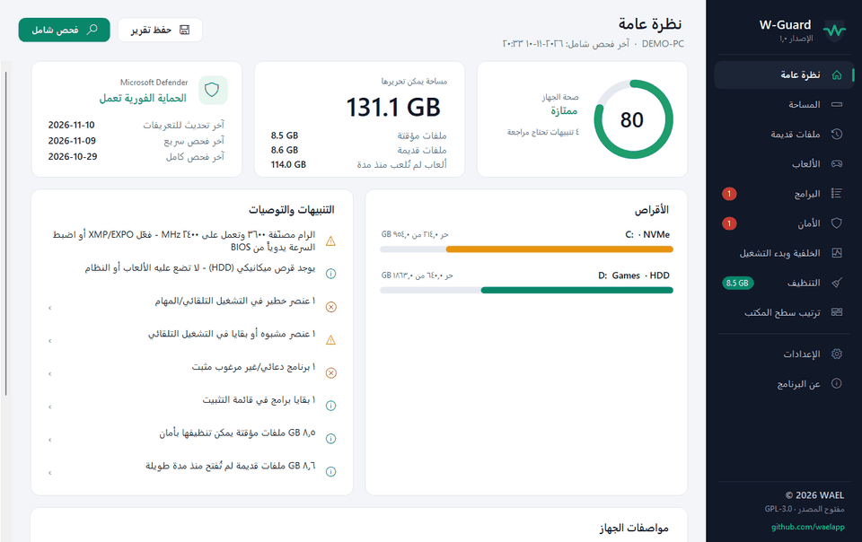
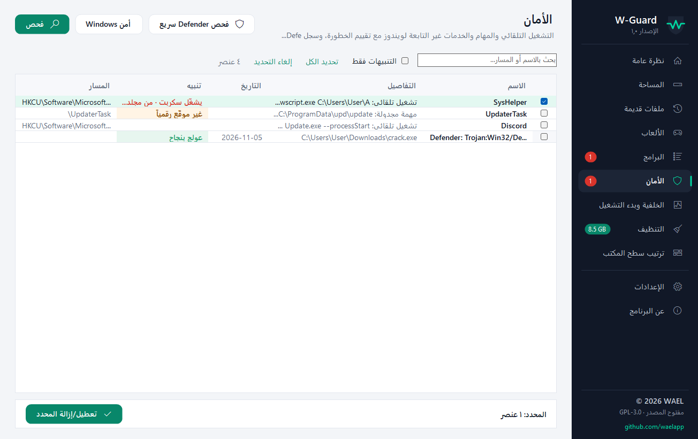
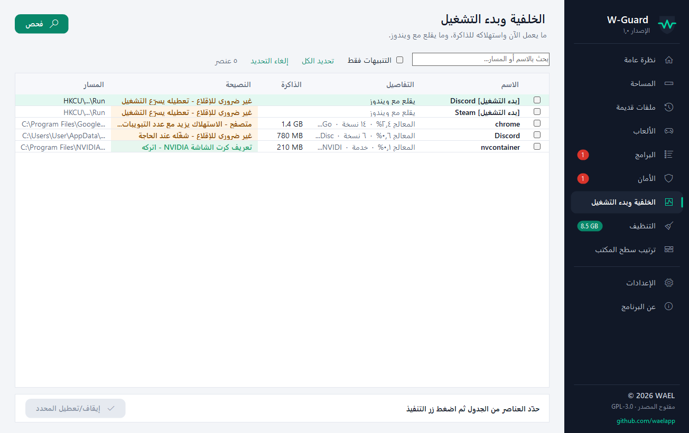
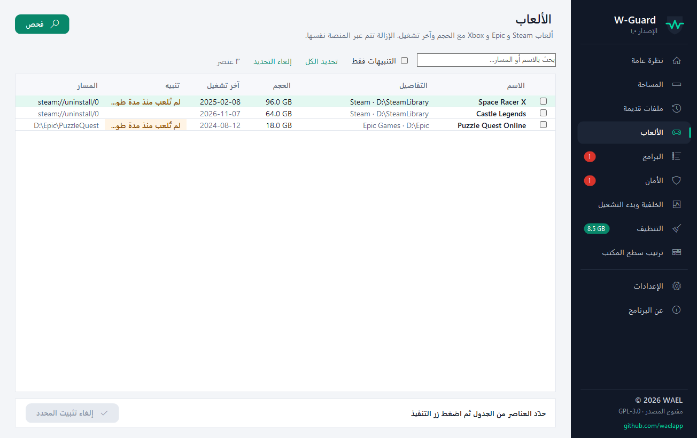
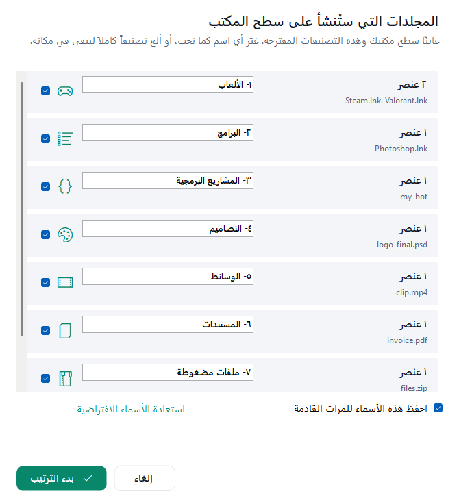

  

<h1 align="center">W-Guard</h1>

  <b>افحص جهازك، نظّفه، واحمِه — بقرارك أنت.</b> 
  فحص شامل وتقييم لصحة الجهاز، كشف ما يأخذ المساحة وما يبطّئ الإقلاع وما يبدو مشبوهاً، وترتيب سطح المكتب. لا يُنفَّذ شيء إلا بعد تأكيدك. 
  Scan, clean, protect and organize your Windows PC — nothing changes until you confirm.

  <a href="https://waelapp.github.io/W-Guard/">الموقع</a> ·
  <a href="#لماذا-w-guard">لماذا W-Guard</a> ·
  <a href="#المقارنة">المقارنة</a> ·
  <a href="#الأقسام">الأقسام</a> ·
  <a href="#الخصوصية">الخصوصية</a> ·
  <a href="#التنزيل">التنزيل</a> ·
  <a href="#english">English</a>

  
  
  
  
  
  
  

   
  بيانات تجريبية — Sample data

## لماذا W-Guard

- **أنت صاحب القرار.** الفحص للقراءة فقط، وكل حذف أو تعطيل يظهر في نافذة تأكيد قبل التنفيذ.
- **آمن افتراضياً.** الحذف إلى سلة المحذوفات، وملفات ويندوز محمية، وكل عملية تُسجَّل ويمكن التراجع عنها.
- **يشرح لماذا.** كل عنصر معه سبب واضح: لماذا يُقترح حذفه أو تعطيله، وكم يوفّر.
- **كل شيء في مكان واحد.** المساحة، الألعاب، البرامج، التشغيل التلقائي، الملفات المؤقتة، وترتيب سطح المكتب.
- **بدون إعلانات أو تتبّع.** لا يرسل أي بيانات عن جهازك.
- **عربي و English.** واجهة كاملة باللغتين.
- **مفتوح المصدر بالكامل** بترخيص GPL-3.0.

## المقارنة

| | **W-Guard** | CCleaner (المجاني) | BleachBit | تنظيف القرص في ويندوز |
|---|:---:|:---:|:---:|:---:|
| مجاني بالكامل بدون نسخة مدفوعة | ✅ | ❌ | ✅ | ✅ |
| مفتوح المصدر | ✅ | ❌ | ✅ | ❌ |
| تنظيف الملفات المؤقتة والكاش | ✅ | ✅ | ✅ | ✅ |
| أكبر المجلدات والملفات في كل الأقراص | ✅ | ✅ | ❌ | ❌ |
| إدارة برامج بدء التشغيل | ✅ | ✅ | ❌ | ❌ |
| تقييم خطورة التشغيل التلقائي والمهام المجدولة | ✅ | ❌ | ❌ | ❌ |
| ألعاب Steam و Epic و Xbox بالحجم وآخر تشغيل | ✅ | ❌ | ❌ | ❌ |
| ترتيب سطح المكتب مع زر تراجع | ✅ | ❌ | ❌ | ❌ |
| تقييم صحة الجهاز من 100 | ✅ | ❌ | ❌ | ❌ |

## الأقسام

### نظرة عامة
- تقييم لصحة الجهاز من 100 بعد الفحص الشامل
- المساحة القابلة للتحرير، وحالة Microsoft Defender، والأقراص ونوعها (NVMe / SSD / HDD)
- تنبيهات ذكية مرتبة بالأهمية، وحفظ تقرير HTML كامل

### الفحص الشامل
- عدّاد للوقت المنقضي وآخر تنازلي للوقت المتبقي
- خطوات واضحة: المواصفات، كل قرص، الألعاب، البرامج، الأمان، الخلفية، الملفات المؤقتة

### المساحة والملفات القديمة
- أكبر المجلدات والملفات في كل الأقراص
- ملفات لم تُعدّل منذ مدة تحددها أنت، وملفات النظام للعرض فقط

### الألعاب والبرامج
- ألعاب Steam و Epic و Xbox مع الحجم وآخر تشغيل
- كشف البرامج الدعائية، وبقايا البرامج المحذوفة، والبرامج غير المستخدمة

### الأمان
- التشغيل التلقائي والمهام المجدولة والخدمات مع تقييم الخطورة
- كشف السكربتات المخفية و PowerShell المشفّر والأسماء المقلّدة
- سجل تهديدات Microsoft Defender، ونسخة احتياطية لمدخلات السجل قبل حذفها

### الخلفية وبدء التشغيل
- استهلاك الذاكرة والمعالج لكل برنامج يعمل الآن
- نصيحة لكل عنصر: مهم — اتركه، أو غير ضروري عند الإقلاع

### التنظيف
- ملفات ويندوز المؤقتة، وكاش NVIDIA و AMD و DirectX، وكاش المتصفحات و Discord و Steam

### ترتيب سطح المكتب
- تصنيف ذكي في 8 مجلدات: الألعاب، البرامج، البرمجة، التصاميم، الوسائط، المستندات، المضغوطة، للمراجعة
- تستعرض المجلدات وتسمّيها كما تحب قبل البدء، وزر تراجع يعيد كل شيء

| | |
|:---:|:---:|
|  |  |
| الأمان وتقييم الخطورة | الخلفية وبدء التشغيل |
|  |  |
| الألعاب | ترتيب سطح المكتب |

## الخصوصية

- الاتصال الوحيد بالإنترنت: طلب واحد عند التشغيل إلى `api.github.com` لمعرفة رقم آخر إصدار، ويمكن إيقافه من الإعدادات.
- لا يُرسل أي شيء عن جهازك، ولا توجد إعلانات أو إحصائيات استخدام.
- البرنامج لا ينزّل ولا يشغّل أي ملف بنفسه: عند صدور إصدار جديد يظهر تنبيه، والتنزيل يتم من متصفحك.

## التنزيل

من صفحة [Releases](https://github.com/waelapp/W-Guard/releases/latest) فقط — أي نسخة من مكان آخر ليست رسمية.

| الملف | لمن |
|---|---|
| [`W-Guard-Setup.exe`](https://github.com/waelapp/W-Guard/releases/latest/download/W-Guard-Setup.exe) | ملف التثبيت — الأفضل لأغلب المستخدمين، يضيف اختصارات ويُزال من «التطبيقات المثبتة» |
| [`W-Guard.exe`](https://github.com/waelapp/W-Guard/releases/latest/download/W-Guard.exe) | نسخة محمولة تعمل مباشرة بدون تثبيت |

**المتطلبات:** ويندوز 10 أو 11 (64-bit) · .NET Framework 4.8 (موجود في ويندوز) · صلاحيات المدير · أقل من 3 MB

## الأسئلة الشائعة

**هل يحذف شيئاً بدون إذني؟**
لا. أي حذف أو تعطيل يحتاج أن تحدد العناصر بنفسك ثم توافق على نافذة تأكيد.

**هل يغني عن برنامج الحماية؟**
لا، W-Guard ليس مضاد فيروسات. يعتمد على Microsoft Defender ويكمّله.

**ظهرت رسالة «Windows protected your PC»؟**
لأن البرنامج جديد. اضغط «More info» ثم «Run anyway»، ونزّله دائماً من صفحة Releases الرسمية فقط.

**رتبت سطح المكتب ولم يعجبني؟**
من «ترتيب سطح المكتب» اضغط «تراجع عن الترتيب» ويعود كل عنصر لمكانه.

## الملاحظات

واجهت مشكلة أو عندك فكرة؟ [بلّغ عن مشكلة](https://github.com/waelapp/W-Guard/issues/new?template=1-quick.yml) · [اقترح فكرة](https://github.com/waelapp/W-Guard/issues/new?template=3-idea.yml) — وإذا أعجبك البرنامج ادعمه بنجمة ⭐ في أعلى الصفحة.

## الترخيص

الكود مرخّص بـ **GNU GPL v3.0**. اسم **W-Guard** والشعار ليسا جزءاً من الترخيص — راجع [TRADEMARK.md](TRADEMARK.md). للإبلاغ عن ثغرة أمنية راجع [SECURITY.md](SECURITY.md).

---

## English

**W-Guard** is a free, open-source Windows tool that scans your PC, rates its health, and suggests fixes that run **only after you confirm**.

- Read-only scanning; every delete or disable is listed in a confirmation window first.
- Deletes go to the Recycle Bin by default; Windows files are protected; every action is logged and can be undone.
- Disk space, games (Steam / Epic / Xbox), programs, autostart risk rating, background & startup advice, cleanup, desktop organizer.
- No ads, no telemetry. The only network access is a version check against `api.github.com`, which can be turned off.
- Arabic and English interface.

**Download:** [Releases](https://github.com/waelapp/W-Guard/releases/latest) · **Feedback:** [Issues](https://github.com/waelapp/W-Guard/issues/new/choose) · **License:** GPL-3.0 (the W-Guard name and logo are not covered — see [TRADEMARK.md](TRADEMARK.md))

© 2026 <b>WAEL</b> · <a href="https://github.com/waelapp">github.com/waelapp</a>

