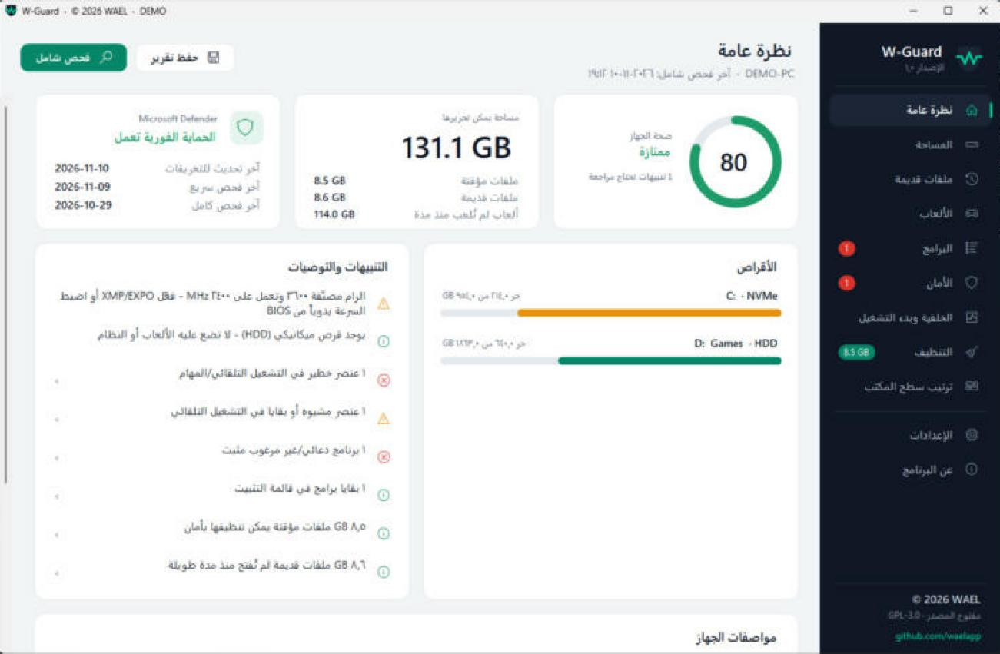
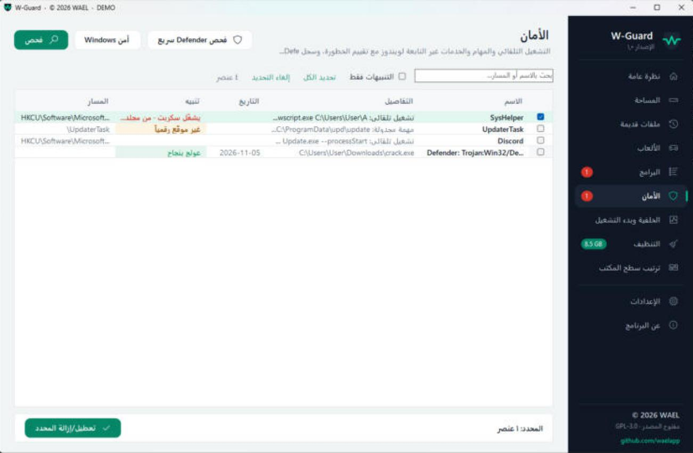
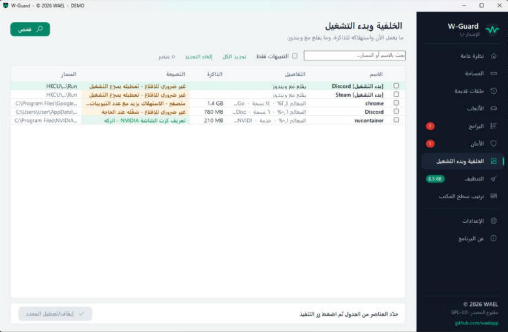
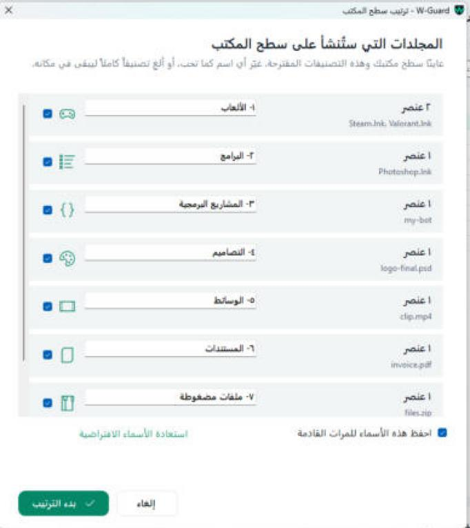

<p align="center">
  
</p>

<h1 align="center">W-Guard</h1>

<p align="center">
  فحص وتنظيف وحماية وترتيب الكمبيوتر - لويندوز 10 و 11<br>
  Scan, clean, protect and organize your Windows PC
</p>

<p align="center">
  <a href="https://github.com/waelapp/W-Guard/releases/latest">تنزيل آخر إصدار / Download</a> ·
  <a href="https://waelapp.github.io/W-Guard/">الموقع / Website</a> ·
  <a href="LICENSE">GPL-3.0</a> ·
  <a href="https://github.com/waelapp">github.com/waelapp</a>
</p>

<p align="center"></p>

---

## العربية

**W-Guard** برنامج مجاني ومفتوح المصدر يفحص جهازك ويعطيك تقييماً لصحته، ثم يقترح الحلول وينفّذها **بعد تأكيدك فقط**.

### الأقسام
| القسم | ماذا يفعل |
|---|---|
| نظرة عامة | تقييم صحة الجهاز من 100، المساحة القابلة للتحرير، حالة Microsoft Defender، الأقراص، التنبيهات، المواصفات |
| المساحة | أكبر المجلدات والملفات في كل الأقراص |
| ملفات قديمة | ملفات لم تُعدّل منذ مدة تحددها أنت |
| الألعاب | ألعاب Steam و Epic و Xbox مع الحجم وآخر تشغيل |
| البرامج | البرامج المثبتة مع كشف البرامج الدعائية والبقايا وغير المستخدمة |
| الأمان | التشغيل التلقائي والمهام المجدولة والخدمات مع تقييم الخطورة، وسجل Defender |
| الخلفية وبدء التشغيل | استهلاك الذاكرة والمعالج لكل برنامج، ونصيحة: هل هو مهم للإقلاع؟ |
| التنظيف | الملفات المؤقتة والكاش التي يُعاد إنشاؤها تلقائياً |
| ترتيب سطح المكتب | تصنيف ذكي في مجلدات تسمّيها أنت، مع زر تراجع |

### صور من البرنامج (بيانات تجريبية)
| | |
|---|---|
|  |  |
| الفحص الشامل مع عدّاد الوقت | الأمان وتقييم الخطورة |
|  |  |
| الخلفية وبدء التشغيل مع النصائح | ترتيب سطح المكتب بأسماء تختارها |

### مبادئ الأمان
- الفحص **للقراءة فقط**، ولا يُحذف أو يُعطَّل شيء قبل أن تختاره وتؤكد.
- الحذف إلى **سلة المحذوفات** افتراضياً، وملفات ويندوز والمجلدات الحساسة محمية.
- كل عملية تُسجَّل، ومدخلات السجل (Registry) تُنسخ احتياطياً قبل حذفها.
- الاتصال الوحيد بالإنترنت هو التحقق من التحديثات من هذه الصفحة، ولا يُرسل أي بيانات عن جهازك.
- التحديث لا يُقبل إلا إذا طابقت بصمته **SHA-256** الملف المنشور مع الإصدار.

### مفحوص على VirusTotal
كل ملفات الإصدار مرفوعة على VirusTotal ومفحوصة بأكثر من 70 برنامج حماية:
- [نتيجة ملف التثبيت W-Guard-Setup.exe](https://www.virustotal.com/gui/file/11cea43135ba53f3ecbb7c335300832523aeab8b4669530ea859dd4e26313803)
- [نتيجة النسخة المحمولة W-Guard.exe](https://www.virustotal.com/gui/file/8335ff20286ea19689f3a015e863947c9a2480287852386cce4a2a54171c2734)

### التنزيل
من صفحة [Releases](https://github.com/waelapp/W-Guard/releases/latest) فقط. أي نسخة من مكان آخر ليست رسمية.
- **`W-Guard-Setup.exe`** - ملف التثبيت (الأفضل لأغلب المستخدمين): يضيف اختصاراً في قائمة ابدأ وسطح المكتب، ويظهر في التطبيقات المثبتة ويُزال منها.
- **`W-Guard.exe`** - نسخة محمولة تعمل مباشرة بدون تثبيت.

### البناء من المصدر
لا يحتاج أي برنامج إضافي - فقط .NET Framework 4.8 الموجود في ويندوز:
```
build.bat
```
يخرج `W-Guard.exe`، وإذا كان [Inno Setup 6](https://jrsoftware.org/isdl.php) مثبتاً يخرج أيضاً `W-Guard-Setup.exe`.

---

## English

**W-Guard** is a free, open-source tool that scans your PC, rates its health, and suggests fixes that run **only after you confirm**.

- Read-only scanning; nothing changes without your selection and confirmation.
- Deletes go to the Recycle Bin by default; Windows and sensitive folders are protected.
- Every action is logged; registry values are backed up before removal.
- The only network access is the update check against this repository; no data about your PC is sent.
- Updates are accepted only when their SHA-256 matches the hash published with the release.
- Arabic and English interface.

**VirusTotal:** [installer](https://www.virustotal.com/gui/file/11cea43135ba53f3ecbb7c335300832523aeab8b4669530ea859dd4e26313803) · [portable](https://www.virustotal.com/gui/file/8335ff20286ea19689f3a015e863947c9a2480287852386cce4a2a54171c2734)

**Build:** run `build.bat` (needs only .NET Framework 4.8, built into Windows).

---

## الترخيص / License
الكود مرخّص بـ **GNU GPL v3.0**: يحق لأي شخص استخدامه وتعديله، بشرط أن تبقى أي نسخة معدّلة منشورة مفتوحة المصدر بنفس الترخيص مع الإبقاء على حقوق المؤلف.

اسم **W-Guard** والشعار ليسا جزءاً من الترخيص - راجع [TRADEMARK.md](TRADEMARK.md).

The code is licensed under **GNU GPL v3.0**. The name "W-Guard" and its logo are not covered by the license - see [TRADEMARK.md](TRADEMARK.md).

© 2026 **WAEL** · [github.com/waelapp](https://github.com/waelapp)
